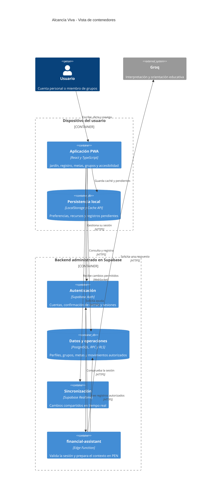

# Alcancía Viva

> **Educación financiera con un jardín que crece contigo.**<br>
> Proyecto del curso **CC451 – Interacción Humano-Computador**, Universidad Nacional de Ingeniería (UNI).

[](LICENSE)
[](package.json)
[](package.json)
[](public/manifest.json)
[](docs/SUPABASE.md)

**[Abrir la aplicación](https://alcancia-viva-jardin.netlify.app)** · **[Repositorio del equipo](https://github.com/ingac98/Alcancia-Viva)** · **[Guía de instalación](docs/INSTALL.md)** · **[Datos simulados](data/mock_data.json)**

En la rama `feat/jardin-vivo-por-metas` se puede [probar el jardín dinámico integrado](https://jardin-integrado--alcancia-viva-jardin.netlify.app). Esta versión tiene un despliegue separado; `main` y la página de exposición conservan su versión actual. [Alcance y validación del jardín](docs/jardin-vivo-integracion.md).


## Contenido

1. [Descripción del proyecto](#1-descripción-del-proyecto)
2. [Características principales](#2-características-principales)
3. [Arquitectura del sistema: modelo C4](#3-arquitectura-del-sistema-modelo-c4)
4. [Tecnologías y APIs utilizadas](#4-tecnologías-y-apis-utilizadas)
5. [Instalación y ejecución](#5-instalación-y-ejecución)
6. [Datos simulados y demostración](#6-datos-simulados-y-demostración)
7. [Requerimientos del curso](#7-requerimientos-del-curso)
8. [Estructura del repositorio](#8-estructura-del-repositorio)
9. [Validación y evidencias](#9-validación-y-evidencias)
10. [Equipo y licencia](#10-equipo-y-licencia)

## 1. Descripción del proyecto

**Alcancía Viva** es una PWA de educación financiera que permite registrar ingresos, gastos y aportes de ahorro mediante texto, voz o un formulario. Los movimientos se expresan en **soles peruanos (PEN, S/)** y cada aporte de ahorro se vincula con una meta concreta.

El progreso se representa mediante un **jardín realista**, acompañado de importes, porcentajes y descripciones textuales. Las metas pueden ser personales o compartidas en grupos privados. La aplicación trabaja con registros de práctica; no conecta cuentas bancarias ni realiza transferencias.

El diseño aplica los tres niveles emocionales de Don Norman:

| Nivel | Aplicación en Alcancía Viva |
| --- | --- |
| **Visceral** | Jardín fotográfico, colores naturales y una presentación visual que invita a participar. |
| **Conductual** | Registro con revisión antes de guardar, elección de la meta, categorías y opción de revertir movimientos propios. |
| **Reflexivo** | Seguimiento del progreso, colaboración y orientación educativa del asistente con un tono sin juicios. |

## 2. Características principales

- **Registro multimodal:** entrada por voz, texto y formulario, con transcripción revisable y lectura de respuestas.
- **Destino explícito del ahorro:** el usuario confirma a qué meta aporta. Si el destino es ambiguo, se solicita su selección.
- **Una maceta por meta:** seis etapas de crecimiento según el porcentaje ahorrado, selección de la maceta para consultar su estado y registro del aporte con su destino preseleccionado. El jardín general promedia las metas personales y grupales; también se puede filtrar por espacio. El plazo orienta el mensaje sin quitar el crecimiento conseguido.
- **Colaboración real:** varias personas pueden aportar a una meta y recibir actualizaciones en tiempo real.
- **Historial por integrante:** cada aporte identifica a su autor, monto, fecha y meta. El resumen por integrante excluye los movimientos revertidos y separa los grupos.
- **Varios grupos y metas:** una cuenta puede participar en distintos grupos, cada uno con varias metas.
- **Invitación con aprobación:** el código o enlace genera una solicitud; el administrador decide si la persona ingresa.
- **Privacidad por usuario y grupo:** los gastos e ingresos personales permanecen privados. En el grupo se comparten los aportes asociados a sus metas.
- **Asistente educativo con IA:** interpreta movimientos y ayuda a comprender los registros. Trabaja en soles y solicita información cuando falta contexto.
- **Personalización persistente:** preferencias de contraste, tamaño de texto, movimiento y audio; aprendizaje de categorías mediante confirmaciones repetidas.
- **PWA y reconexión:** recursos estáticos en caché y movimientos pendientes por usuario para sincronización posterior.

La disponibilidad de reconocimiento de voz depende del navegador y de sus permisos. La alternativa escrita permanece disponible. La colaboración y las consultas al asistente necesitan conexión.

## 3. Arquitectura del sistema: modelo C4

### Vista de contenedores — C4 nivel 2

La interfaz se ejecuta en el navegador y sus archivos se distribuyen desde **Netlify**. **Supabase** proporciona autenticación, base de datos, operaciones autorizadas, sincronización y la función que accede a **Groq**.



Las vistas de **contexto, contenedores y componentes**, junto con los flujos de invitación y ahorro, se encuentran en [la documentación de arquitectura C4](docs/architecture/c4-model.md).

Los permisos se verifican en el servidor. Un aporte utiliza un identificador estable para evitar duplicados al reintentar, y el avance se calcula a partir de los movimientos no revertidos. La clave privada de Groq permanece en Supabase.

## 4. Tecnologías y APIs utilizadas

| Tecnología o API | Uso en el proyecto |
| --- | --- |
| **React 19 + TypeScript + Vite** | Interfaz, componentes, tipos y compilación del frontend. |
| **Supabase Auth** | Registro, confirmación por correo e inicio y cierre de sesión. |
| **Supabase Database / PostgREST y RPC** | Persistencia y operaciones con permisos por fila mediante PostgreSQL y RLS. |
| **Supabase Realtime** | Actualización de metas y aportes entre usuarios conectados. |
| **Supabase Edge Functions** | Endpoint autenticado `financial-assistant`; mantiene la clave de IA fuera del navegador. |
| **Groq API** | Modelo `openai/gpt-oss-20b` para interpretar texto y ofrecer orientación educativa. |
| **Web Speech API** | Reconocimiento de voz y síntesis de respuestas en español de Perú. |
| **Service Worker, Cache API y LocalStorage** | Recursos de la PWA y persistencia local para reconexión. |
| **Netlify** | Alojamiento HTTPS de la interfaz. |
| **GitHub** | Código, documentación, datos simulados y evidencias del proyecto. |

Las imágenes del jardín son recursos incluidos en el repositorio; su visualización no requiere llamadas a una API de imágenes. Su elaboración se documenta en [public/garden/README.md](public/garden/README.md).

## 5. Instalación y ejecución

### Requisitos

- **Node.js 22.18 o posterior**, con npm.
- **Git** para clonar el repositorio.
- Navegador actualizado. Para voz, debe ofrecer reconocimiento de voz y tener permiso de micrófono.
- Conexión a internet para cuentas, colaboración y asistente.

### Inicio rápido

```bash
git clone https://github.com/ingac98/Alcancia-Viva.git
cd Alcancia-Viva
npm ci
npm run dev
```

Abrir la dirección indicada por Vite, normalmente **http://localhost:5173**. Si ese puerto está ocupado, utilizar el que muestre la terminal.

La configuración pública del proyecto compartido de Supabase ya está incluida. Para usar otro proyecto, copiar `.env.example` como `.env.local` y configurar:

```dotenv
VITE_SUPABASE_URL=https://tu-proyecto.supabase.co
VITE_SUPABASE_PUBLISHABLE_KEY=tu-clave-publicable
```

En PowerShell se puede copiar el archivo con `Copy-Item .env.example .env.local`; en Linux o macOS, con `cp .env.example .env.local`. `GROQ_API_KEY` se guarda como secreto de la función en Supabase.

### Primer uso

1. Crear una cuenta, confirmar el correo e iniciar sesión.
2. Crear una meta personal o un grupo con metas compartidas.
3. Registrar un ingreso o gasto indicando su categoría.
4. Para ahorrar, registrar un aporte y seleccionar su meta.
5. Invitar a otra persona mediante código o enlace y aprobar su solicitud desde **Mis grupos**.

### Compilación y publicación

```bash
npm run build
npm run preview
```

La compilación genera `dist/`. La guía completa cubre el uso local, otro proyecto de Supabase, la PWA y Netlify:

- [Guía de instalación y primer uso](docs/INSTALL.md).
- [Configuración del backend de Supabase](docs/SUPABASE.md).
- [Publicación en Netlify](docs/NETLIFY.md).

La versión pública está en [alcancia-viva-jardin.netlify.app](https://alcancia-viva-jardin.netlify.app). La publicación de nuevos cambios se realiza manualmente; la conexión automática con GitHub se configura aparte.

## 6. Datos simulados y demostración

El repositorio incluye [data/mock_data.json](data/mock_data.json), un conjunto **completamente ficticio** para reproducir recorridos de demostración:

| Contenido | Cantidad |
| --- | --- |
| Periodo de ejemplo | 30 días: del 13 de octubre al 11 de noviembre de 2026 |
| Participantes ficticios | 2 |
| Grupos | 2 |
| Metas | 6: 2 personales y 4 compartidas |
| Movimientos | 42: 4 ingresos, 30 gastos y 8 aportes de ahorro |
| Moneda | Sol peruano: PEN, S/ |

Incluye las metas **Laptop**, **Fondo de emergencia**, **Viaje a Cusco**, **Emergencia familiar**, **Materiales** y **Feria estudiantil**, además de los resultados esperados para comprobar importes y progreso.

**Uso:** seguir [la guía de datos y escenarios](data/README.md) y registrar los ejemplos desde la interfaz con cuentas propias de prueba. El JSON sirve como referencia reproducible; las cuentas nuevas empiezan vacías y el archivo no se importa automáticamente. No incluye contraseñas, sesiones ni datos de personas reales.

Ejemplos de entrada:

- `Gasté 15 soles en almuerzo` → gasto de alimentación.
- `Recibí 500 soles por un trabajo` → ingreso de trabajo.
- `Ahorré 100 soles para Viaje a Cusco` → aporte que requiere revisar y confirmar la meta.
- `Ahorré 100 soles` → el sistema solicita seleccionar el destino.

## 7. Requerimientos del curso

| Requerimiento | Implementación y evidencia en el repositorio |
| --- | --- |
| **README y repositorio GitHub** | Descripción, instalación, arquitectura, equipo y licencia en este documento. |
| **Arquitectura C4** | [Contexto, contenedores y componentes](docs/architecture/c4-model.md). |
| **Guía de instalación** | [docs/INSTALL.md](docs/INSTALL.md) y [configuración de Supabase](docs/SUPABASE.md). |
| **Datos simulados incluidos** | [Dataset de 30 días](data/mock_data.json) y [escenarios reproducibles](data/README.md). |
| **Interfaz de voz** | [Reconocimiento y síntesis](src/services/voice/speechService.ts), con alternativa escrita. |
| **LLM mediante API** | [Función del asistente](supabase/functions/financial-assistant/index.ts) y [reglas de moneda](supabase/functions/financial-assistant/currency-policy.ts). |
| **Plataforma PWA** | [Manifiesto](public/manifest.json) y [service worker](public/sw.js). |
| **Personalización continua** | Perfil persistente, preferencias y aprendizaje de categorías en [src/live/](src/live/). |
| **Multiusuario y colaboración** | Grupos, solicitudes, roles, múltiples metas y aportes compartidos; [migraciones](supabase/migrations/). |
| **Diseño emocional** | Jardín, revisión del registro, descripción textual y orientación educativa. |
| **Accesibilidad** | Teclado, controles etiquetados, mensajes de estado, contraste, texto grande y reducción de movimiento. |

## 8. Estructura del repositorio

```text
Alcancia-Viva/
├── data/                        # Datos ficticios y escenarios de demostración
├── docs/
│   ├── architecture/c4-model.md # Diagramas y decisiones de arquitectura
│   ├── evidence/                # Capturas y resultados de verificaciones
│   ├── INSTALL.md              # Instalación y primer uso
│   ├── SUPABASE.md             # Backend, permisos y pruebas
│   └── NETLIFY.md              # Publicación y dominio
├── public/                      # Jardín, iconos, manifiesto y service worker
├── scripts/                     # Verificaciones del dominio y del asistente
├── src/
│   ├── live/                    # Interfaz colaborativa, cliente y reglas
│   └── services/voice/          # Reconocimiento y síntesis de voz
├── supabase/
│   ├── functions/               # Asistente educativo en el servidor
│   ├── migrations/              # Esquema, permisos y operaciones
│   └── tests/                   # Pruebas de autorización y concurrencia
├── .env.example                 # Variables públicas de ejemplo
├── netlify.toml                 # Configuración de alojamiento
└── package.json                 # Dependencias y comandos
```

## 9. Validación y evidencias

```bash
node scripts/verify-domain.mjs
node scripts/verify-assistant.mjs
```

Las verificaciones cubren interpretación de movimientos, destino del ahorro, ambigüedad, montos, cálculo semanal, reglas del jardín y respuestas del asistente en soles.

Las pruebas de integración registraron autenticación, aprobación de solicitudes, privacidad de gastos, múltiples grupos y metas, aportes simultáneos, ausencia de duplicados y eventos Realtime. Sus resultados y capturas están en [docs/evidence/](docs/evidence/), incluida la [verificación del despliegue en Netlify](docs/evidence/netlify-deployment.json).

Las pruebas SQL que sustituyen Auth están destinadas a una base local desechable. Su ejecución se explica en [docs/SUPABASE.md](docs/SUPABASE.md); `local-bootstrap.sql` no se ejecuta sobre el proyecto compartido. El micrófono, los lectores de pantalla y el uso completo sin conexión se evalúan con los dispositivos y usuarios de las sesiones de prueba.

## 10. Equipo y licencia

| Integrante | Código |
| --- | --- |
| Villanueva Alzamora, Farid Alonzo | 20234010G |
| Espinoza Benavente, Hector | 20222109C |
| Inga Chavez, Jorly | 20220467J |
| Mori Malca, Jean Paul | 20245016A |

**Curso:** CC451 – Interacción Humano-Computador<br>
**Universidad:** Universidad Nacional de Ingeniería<br>
**Periodo:** 2026-II

Proyecto distribuido bajo la **licencia MIT**. Consultar [LICENSE](LICENSE). La demo de referencia del equipo se encuentra en [Faalvial/Alcancia-Viva](https://github.com/Faalvial/Alcancia-Viva).
