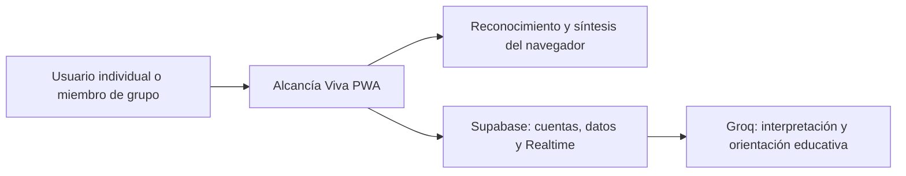

# Arquitectura de Alcancía Viva

## C4 nivel 1: contexto

## C4 nivel 2: contenedores

| Contenedor | Responsabilidad |
| --- | --- |
| PWA React + TypeScript + Vite | Interfaz accesible, jardín fotográfico, registro y selección explícita del destino |
| Service worker y almacenamiento local | Recursos estáticos; perfil y movimientos pendientes por usuario para reconexión |
| Supabase Auth | Registro, confirmación por correo y sesiones |
| PostgreSQL y funciones validadas | Perfiles, grupos, membresías, invitaciones, solicitudes, metas y movimientos; permisos por fila |
| Supabase Realtime | Entrega cambios autorizados a los miembros conectados |
| Función financial-assistant | Valida la sesión, consulta solo datos autorizados y llama a Groq con una clave guardada en el servidor |

## C4 nivel 3: componentes y operaciones

- `src/live/client.ts`: cliente público de Supabase y carga de los datos permitidos al usuario.
- `src/live/CollaborativeApp.tsx`: cuenta, jardín, metas, grupos, solicitudes, movimientos, asistente y preferencias.
- `src/live/domain.ts`: interpretación local de respaldo, semana local, dinero y regla del jardín.
- `src/services/voice/speechService.ts`: entrada y salida de voz del navegador.
- `supabase/functions/financial-assistant/index.ts`: acceso autenticado al modelo de Groq; no realiza movimientos.
- `supabase/migrations`: operaciones públicas sin privilegios propios delegan en funciones privadas con validaciones explícitas. Los clientes no escriben directamente membresías ni movimientos.

## Flujos y límites

Solicitud de ingreso: invitación válida → solicitud pendiente → aprobación del administrador → membresía. Mientras esté pendiente no hay acceso al contenido del grupo.

Aporte: tipo ahorro → meta autorizada → movimiento con ID estable → total calculado desde movimientos no revertidos → evento compartido. Cada meta pertenece a un espacio individual o a un grupo; pertenecer a un grupo no da acceso a otros.

No se conectan bancos ni se mueve dinero real. La UI explica las reglas del jardín y ofrece una representación textual equivalente. Las claves administrativas y de IA nunca se incluyen en el cliente.
