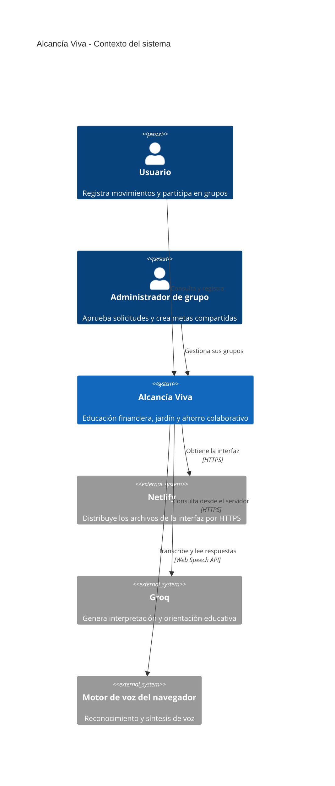
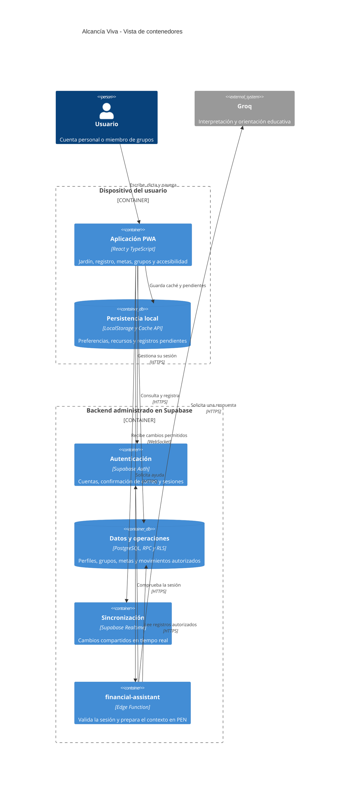
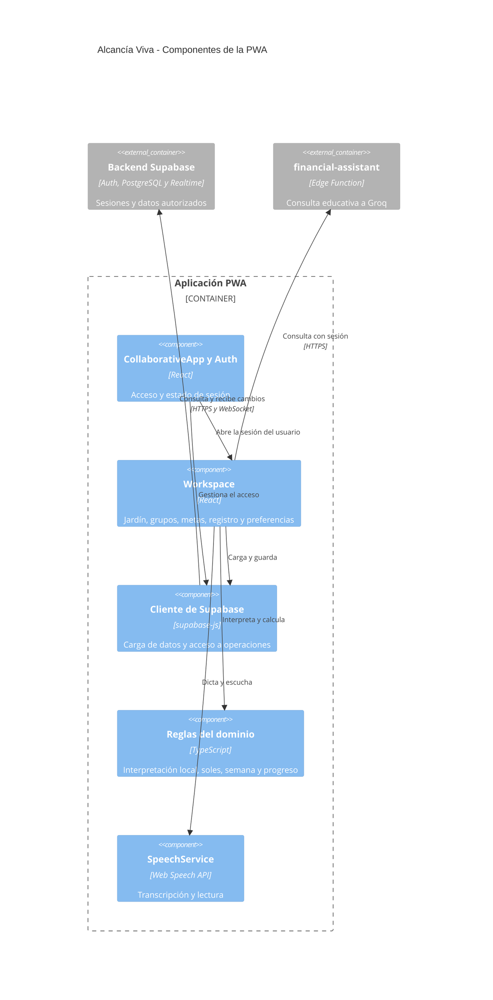

# Arquitectura de Alcancía Viva — modelo C4

Este documento describe la aplicación publicada en [Netlify](https://alcancia-viva-jardin.netlify.app) y el código de [ingac98/Alcancia-Viva](https://github.com/ingac98/Alcancia-Viva). Las vistas se representan con la sintaxis C4 de Mermaid.

## Nivel 1: contexto del sistema

El usuario registra movimientos y participa en grupos. Un administrador es un miembro con autorización para gestionar solicitudes y metas de su grupo. La aplicación integra alojamiento web, voz del navegador y orientación educativa mediante Groq.

## Nivel 2: contenedores

### Responsabilidad de cada contenedor

| Contenedor | Responsabilidad | Implementación |
| --- | --- | --- |
| Aplicación PWA | Interfaz, jardín, registro, metas, grupos, asistente y preferencias | React, TypeScript y Vite; archivos alojados en Netlify |
| Persistencia local | Caché de recursos, perfil, instantánea y movimientos pendientes por usuario | Service worker, Cache API y LocalStorage |
| Autenticación | Registro, confirmación de correo y validación de sesiones | Supabase Auth |
| Datos y operaciones | Perfiles, grupos, membresías, invitaciones, solicitudes, metas y movimientos | PostgreSQL, RLS y funciones RPC |
| Sincronización | Cambios autorizados para clientes conectados | Supabase Realtime sobre WebSocket |
| Asistente | Autentica, obtiene contexto permitido, fija PEN y valida la moneda de la respuesta | Edge Function `financial-assistant` y Groq API |

El código de la PWA se ejecuta en el dispositivo. Netlify distribuye la compilación estática; las operaciones y los datos compartidos se resuelven en Supabase. La caché local ayuda a recuperar recursos y conservar registros pendientes, mientras las operaciones compartidas y la IA requieren internet.

## Nivel 3: componentes de la PWA

| Componente | Archivo |
| --- | --- |
| Acceso, espacio de trabajo y formularios | [CollaborativeApp.tsx](../../src/live/CollaborativeApp.tsx) |
| Cliente, tipos y carga de datos | [client.ts](../../src/live/client.ts) |
| Dinero, categorías, interpretación y jardín | [domain.ts](../../src/live/domain.ts) |
| Entrada y salida de voz | [speechService.ts](../../src/services/voice/speechService.ts) |
| Caché de recursos | [sw.js](../../public/sw.js) |
| Endpoint del asistente | [index.ts](../../supabase/functions/financial-assistant/index.ts) |
| Reglas monetarias del asistente | [currency-policy.ts](../../supabase/functions/financial-assistant/currency-policy.ts) |
| Esquema, permisos y operaciones | [Migraciones](../../supabase/migrations/) |

## Flujos principales

### Ingreso a un grupo

1. Un administrador comparte un código o enlace de invitación vigente.
2. Una persona autenticada envía una solicitud.
3. Mientras esté pendiente, no puede consultar el contenido privado del grupo.
4. El administrador aprueba o rechaza la solicitud.
5. La aprobación crea la membresía y habilita el acceso autorizado a las metas y aportes.

### Registro de ahorro

1. La entrada manual, escrita o de voz produce una propuesta de movimiento.
2. El usuario revisa tipo, importe, categoría, fecha y meta de destino.
3. El servidor valida la sesión y la autorización sobre la meta; de ella obtiene el grupo.
4. Un identificador estable evita duplicar el movimiento al reintentar.
5. El avance se calcula sumando aportes no revertidos.
6. Realtime informa los cambios a los clientes autorizados.

El ingreso y el gasto personal no requieren una meta de ahorro. Un aporte sí la requiere. El asistente propone y explica; el guardado se realiza mediante la operación validada después de la confirmación del usuario.

### Consulta al asistente

1. La PWA envía la consulta a `financial-assistant` con la sesión del usuario.
2. La función comprueba el token con Supabase Auth.
3. Para orientación, obtiene únicamente movimientos propios autorizados y calcula totales fuera del LLM.
4. Envía a Groq la pregunta y el contexto explícito en PEN.
5. Valida la respuesta antes de devolverla; si contiene otra moneda, utiliza una respuesta segura en soles sin inventar una conversión.

## Decisiones y límites

- **Privacidad:** los miembros consultan los aportes compartidos de su grupo. Los gastos, ingresos y preferencias personales pertenecen a su dueño.
- **Autorización:** las políticas RLS y las funciones del servidor controlan el acceso; la interfaz refleja esos permisos.
- **Consistencia:** las sumas se derivan de movimientos, con reintentos y reversión por autor.
- **Secretos:** la URL y clave publicable de Supabase pueden estar en el frontend; `GROQ_API_KEY` permanece en el servidor.
- **Accesibilidad:** la voz tiene alternativa escrita y el jardín tiene descripción e importes textuales.
- **Demostración:** [los datos simulados](../../data/mock_data.json) son referencias ficticias para recorridos manuales, sin cuentas reales ni importación automática.
- **Despliegue:** la publicación actual en Netlify es manual. El enlace automático al repositorio se documenta en [NETLIFY.md](../NETLIFY.md).

Referencia de representación: [diagramas C4 en Mermaid](https://mermaid.js.org/syntax/c4.html).
